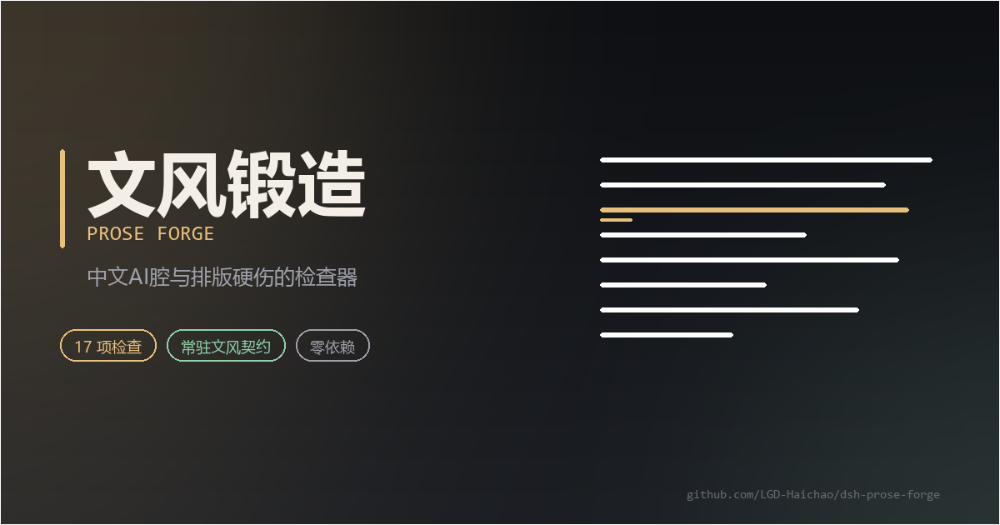

# 文风锻造（dsh-prose-forge）




让DeepSeek Harness 说人话，并且会写文件。

一个插件，三面挂载：

1. **常驻文风契约** — 每轮进系统提示词（order 100）。分两条轨：聊天回复短促直给，写文件时换成完整书面句子、允许定语状语从句；严谨靠给范围而不是删字。写文件时第十一到十六条生效：结构服从内容、标题写名词、句子写完整、限定要实、允许不齐整、交付说清假设。
2. **两个工具** — `prose_check` 一个工具两个入口（`text` 扫文本、`path` 扫文件且全文不进上下文），一次返回文风命中、结构审计、中文排版体检；`prose_rules` 按需取回规则全文。
3. **两个技能** — `prose-forge-write`（写作流程六步）、`prose-forge-doc`（文件交付规范）。

## 怎么跟它说话

不知道该怎么开口，抄 [PROMPTS.md](PROMPTS.md) 里的句子就行。检查、清理、开关某条规则、安装更新，都给了现成说法，方括号里的东西换成自己的。

想挂到技能市场：[LISTING.md](LISTING.md) 里有中文和英文文案、打包好的 zip、截图；[REQUIRES.md](REQUIRES.md) 是必须一起给买家的依赖声明——这东西是插件，只传 SKILL.md 装不起来。

## 为什么这么切

文风约束只有**每轮生效**才有意义。按需触发的skill要用户先说“帮我润色”，规则才想起来——那时候稿子已经写完，AI腔已经落地。所以契约常驻，长清单后置。

代价是明确的，也随时可量（`node measure.mjs`）：契约1162字+工具描述与schema 656 字+技能目录270字 = **每轮固定2088字**。

做过一轮减法。量之前我以为该砍契约，结果工具占了1391字，比契约还多——两个入口各自带着完整描述和schema。合并成 `text | path` 一个工具后降到621；这一轮加排版体检和示例库，又回到656。功能多了两样，每轮成本基本没动。

真正抓“AI 味”的不是词表，是结构。每段一样长、每句一样长、每节都有小结——这些用词表抓不到。所以扫描器除了正则，还算四个指标：句长变异系数、段落长度变异系数、加粗占比、列表行占比。判定为“有模板腔”时，先看结构问题，再看命中明细。

句长和密度都按**折算单位**算：汉字算1，连续的英文词算2。按字符数算的话，一句英文80个字符必然被判“偏长”，中英混排的密度也会系统性偏低——同一个毛病，中英文各挨一半。

## 装之前

三件事齐了再动手，缺哪件都会卡在半路：

- DSH 能正常启动，插件页能打开
- Node ≥ 20（插件本身零依赖，但装的时候要用 pnpm）
- 能访问 GitHub

profile 名不确定的话，看一眼 `~/.dsh/profiles/` 下面有哪些目录。桌面版一般叫 `desktop`，网页版叫 `web`。

## 装

```sh
dsh plugin --profile desktop add github:LGD-Haichao/dsh-prose-forge
```

开发时想让改动直接生效，用 link 指到本地目录：

```sh
dsh plugin --profile desktop add "link:/path/to/dsh-prose-forge"
```

## 确认装上了

三个信号，看到两个就算成功：

1. 插件页里出现「文风锻造 Prose Forge」，开关是开的
2. 新开一个会话，输入框打 `/prose`，能列出两个 skill
3. 随便说一句「扫一下这段：放在Redis里」，能收到带版本号的报告，末尾形如 `· v0.7.0`

版本号对不上或压根没有，说明代码是新的、跑的还是旧的，见下面「改完代码怎么生效」。

## 装不上怎么办

| 现象 | 原因 | 处理 |
| --- | --- | --- |
| `ERR_PNPM_UNEXPECTED_STORE` | profile 的 node_modules 来自别的 store | 命令后面加 `--store-dir=<那个 store 的路径>` |
| 报错里出现「鎼炵偣」这类乱码 | CLI 把中文路径按 GBK 解了 | 插件目录放到纯 ASCII 路径下 |
| 装完工具和技能都没出现 | 没重载 | 见下一节 |
| 命令卡住不动 | 连不上 GitHub | 换网络或配代理；这台机器实测是间歇性的 |

## 改完代码怎么生效

**装插件**时宿主会重组配置并自动挂载，新开一轮就能看到工具和技能；但**改已挂载插件的代码不会热加载**，这是宿主行为，插件自己改不了。

实测结果，比预想的麻烦：

| 手段 | 结果 |
| --- | --- |
| 重跑 `dsh plugin add` | **不生效**，只回一句 `Already up to date` |
| 只翻 profile 里的 `disabled` | **时灵时不灵**，试了两次都没重载 |
| 翻 `disabled` 且插件目录里有 js 文件变了 | **生效**，模块重新加载 |

结论：最靠谱的是**重启 DSH**。想省事就用「改完 js 再翻开关」，但报告里的版本号一定要对一遍——不对就是没重载。

翻开关要改的文件是 `~/.dsh/profiles/<你的profile>/cordis.patch.yml`，末尾 `prose-forge` 那段：

```yaml
- id: prose-forge
  name: dsh-prose-forge
  config:
    typographySkip: []
  disabled: false      # 改成 true，等两秒，再改回 false
```

改**配置**（比如 `typographySkip`）不需要这么折腾，改完即时生效——配置层会重读，代码模块不会。

## 配置

`cordis.patch.yml` 里可传：

| 键 | 默认 | 说明 |
| --- | --- | --- |
| `enabled` | `true` | 关掉整段注入、工具和技能 |
| `order` | `100` | 提示词段排序，默认在persona之后 |
| `registerTools` | `true` | 只留提示词，不注册工具 |
| `registerSkills` | `true` | 不注册两个skill |
| `extraBanned` | `[]` | 追加到契约末尾的禁用表达 |
| `customRules` | `[]` | 追加扫描规则，正则字符串，见下 |
| `typographySkip` | `[]` | 关掉指定的排版检查，填检查项名，见下 |

`customRules` 给团队加家规，不用改代码：

```yaml
- insert:
    - id: prose-forge
      name: dsh-prose-forge
      config:
        customRules:
          - pattern: '本公司|集团'
            group: 品牌用语
            severity: 2
            advice: 对外文案统一用"我们"。
```

正则写错不会把整次扫描带崩，那一条会被跳过并列在报告的「自定义规则有错误」里。

单条排版检查也能关。团队习惯中文与英文之间加空格，就把 `cjk-latin-space` 关掉：

```yaml
- insert:
    - id: prose-forge
      name: dsh-prose-forge
      config:
        typographySkip:
          - cjk-latin-space
```

改完立即生效，不用重启——宿主会重新读这份覆盖层。可关的检查项：`halfwidth-punct`、`halfwidth-punct-mixed`、`halfwidth-period`、`ellipsis`、`dash-double-hyphen`、`dash-single`、`ascii-quote-cn`、`repeat-punct`、`punct-line-start`、`space-before-punct`、`fullwidth-space`、`double-space`、`trailing-space`、`en-punct-cjk`、`halfwidth-paren-cn`、`cjk-latin-space`、`unbalanced-mark`、`fullwidth-alnum`、`invisible-char`。

## 工具

### `prose_check`

一个工具，两种输入：

| 参数 | 行为 |
| --- | --- |
| `text` | 直接扫传入的文本 |
| `path` | 读盘扫文件，**全文不进上下文**，长文档只回报告 |

两者都给时以 `path` 为准；都不给直接报错。

`skip` 传一个检查项名数组，本次扫描就跳过它们，和配置里的 `typographySkip` 合并。想临时看看关掉某条的效果，用它比改配置快。

编码按BOM判断：UTF-8、UTF-8 BOM、UTF-16LE、UTF-16BE都能读——Windows 上「另存为 Unicode」存的是UTF-16LE，按UTF-8硬读会全是乱码，还会被误判成二进制。真二进制（含 `\u0000`）直接拒绝，不瞎猜。

`mode`：`auto`（有markdown标题、或两个以上中文编号标题，就判为文档）/ `chat` / `doc`。`doc` 额外查标题八股和空转表述。`limit`：最多返回多少条命中，默认40。

判定四档：`干净` < `基本干净` < `有模板腔` < `模板腔重`。密度算法是加权严重度÷折算字数 × 300。命中不足3处时最高只判「基本干净」——短文本里一个词就能把密度顶上去，不该给整段定性。

同时返回中文排版体检，和文风**分开算分**——排版错是硬伤，文风是口味，混在一起会互相淹没。19项检查：半角标点（含中文句子里夹英文词的情况）、半角括号包中文、标点前的空格、汉字与英文/数字之间的空格、省略号写成三个点、破折号单个或两个连字符、英文引号包中文、英文句子混中文标点、重复标点、标点出现在行首、全角空格、连续空格、行尾空白，以及引号与括号是否配对。

判定看上下文，不做语种识别：`Wait... let me check` 里的三个点不报（英文省略号合法），`用 --store-dir 装` 也不报（那是命令行参数），但 `等一下...就好`、`段落一 -- 段落二`、`Hello，world` 都会报。

汉字与英文、数字之间不留空格（这条默认关着，需要时用 `prose_fix` 清理）：`放在 Redis 里` → `放在Redis里`、`v2.3.1 版本` → `v2.3.1版本`、`共 3 个` → `共3个`、`跑在 5G 网络上` → `跑在5G网络上`。连接符号同理：`改配置 + 触发重载` 会收成 `改配置+触发重载`，`+`、`&`、`×`、`~` 这几个两侧的空格都收掉；斜杠和竖线不碰，那是路径和表格。

判据只有一条：英文前后不是英文，就不留空格。英文句子内部的空格照旧，`The parser is robust` 不动；英文后面接英文也照旧，`共 3 files` → `共3 files`。

能机械修的直接给改法：`"一,"` → `"一，"`、`"..."` → `"……"`、`"Hello，"` → `"Hello,"`。最后这条只换标点，不补空格。

扫描前先掩掉五类内容：围栏代码块、行内代码（单反引号和双反引号）、URL、二十字以内的引文，以及文件头部的YAML frontmatter。所以 `foo(a,b)` 不会被当成排版错误，正文里引用“值得注意的是”也不会被当成套话，`[名字](https://…)（MIT，Copyright）` 里的中文逗号更不会因为判定窗口落进URL而误报。

引文只掩二十字以内的：长段引用照扫——那里可能真是一段AI腔。掩码用不换行空格，避免把代码替换成一长串空格、反过来触发“连续空格”规则。

给 `path` 时再加四项结构审计。标题两种写法都认：markdown的 `#`，和纯文本报告里的 `一、`（当二级）、`（一）`（当三级）：

| 审计项 | 抓什么 |
| --- | --- |
| `heading-jump` | H2 直接跳到H4 |
| `empty-section` | 标题下面没正文 |
| `long-paragraph` | 单段超过400字 |
| `small-table` | 表格数据行不足2行 |

掩码用不换行空格，且不涂换行——涂掉换行会让后面所有行号前移，报告里的定位全错。

这几项靠眼睛读不出来——20 个段落哪几段一样长、标题跳没跳级，必须靠计数。作者自己审自己的稿子，恰恰最容易漏这一层。

### `prose_rules`

`part` 取 `direct`（十条详解带改写示例）、`doc`（文件写作规范）、`slop`（AI 腔清单）、`workflow`（流程）、`checkpoints`（改稿24个检查点）、`examples`（16 组原文/改写对照）、`all`。

`examples` 是这一轮加的。规则说“删元话语”，改好的样子还得靠例子——模型对着16组对照比对着12条禁令更容易对齐。它按需加载，不占每轮成本。

## 更新

github 装法跟仓库 HEAD 走，pnpm 按 lockfile 里记的 commit 解析。要拉最新版，重跑一次 add：

```sh
dsh plugin --profile <你的 profile> add github:LGD-Haichao/dsh-prose-forge
```

要回滚或钉住某个提交，在仓库名后面加 `#` 和提交号：

```sh
dsh plugin --profile <你的 profile> add "github:LGD-Haichao/dsh-prose-forge#17aa8cf"
```

查当前装的是哪一版：

```sh
node -e "console.log(require('./node_modules/dsh-prose-forge/package.json').version)"
```

装完在本机跑一次自检，确认这份代码能跑：

```sh
node node_modules/dsh-prose-forge/audit.mjs
node node_modules/dsh-prose-forge/selftest.mjs
```

三个脚本都不用装依赖，直接跑：`selftest` 查扫描器，`harness` 查插件挂载形状，`audit` 查规则覆盖和文档一致性。

## 受限网络下推送

有些网络里 `github.com:443` 会被切断，`git push` 一直超时，但 `api.github.com` 还能通。
仓库里带了一个脚本，走 GitHub 的 Git 数据 API 提交，效果和 push 一样：

```powershell
powershell -File scripts/push-via-api.ps1 -ApiIp <可用的 api.github.com 地址>
```

代价是服务端生成的提交号与本地不同，网络恢复后 `git fetch origin && git reset --hard origin/main` 对齐。
细节见 [scripts/README.md](scripts/README.md)。

## 验证记录

这些都是实际跑出来的，不是照着设想写的。

| 做了什么 | 结果 |
| --- | --- |
| 干净目录 `pnpm add github:LGD-Haichao/dsh-prose-forge` | 8.6 秒装完，20 个文件齐全，零依赖 |
| 装好的那份跑三套测试 | 81 + 89 + 17 全过 |
| `pnpm update dsh-prose-forge` | 0.6.2 → 0.6.3，拉的是仓库 HEAD |
| 新建 profile 后 `dsh plugin --profile pf-test add github:…` | 自动写进 `dsh.profile.bundles`，`--dump-config` 能看到 `# == dsh-prose-forge` |
| 已装 0.6.4 的 profile 再跑一次 add | 0.6.4 → 0.6.5，会拉仓库 HEAD |
| `add "github:…#17aa8cf"` 钉提交 | 从 0.6.5 回退到 0.6.4 |
| 更新后跑自检 | 19 项覆盖检查 + 81 项断言全过，`--dump-config` 里挂载行还在 |
| UTF-16BE 往返、目录当文件、文件不存在、空文件、未知 kinds | 行为都正确，没有意外 |

## 跨机器

- 零运行时依赖，`import` 只有 `node:fs`、`node:path`、`node:url` 和本地文件，装完不需要再装任何东西。
- 插件目录放纯 ASCII 路径。Windows 下 CLI 传参会把中文路径转成乱码，这是踩过的坑。
- 换行统一 LF（`.gitattributes` 里钉死），macOS 和 Linux 上不会出现满屏 CRLF 差异。
- 读文件按 BOM 认编码，UTF-8、UTF-8 BOM、UTF-16LE、UTF-16BE 都能读；`prose_fix` 写回时按原编码写，不会把 UTF-16 文件偷偷改成 UTF-8。
- `prose_fix` 只改正文。代码块、行内代码、URL、frontmatter 和短引文一律不动——示例代码里的空格是内容，不是排版错误。

## 自测

```powershell
node selftest.mjs    # 扫描器：脏/净中文、英文、文档模式、掩码、排版、自定义规则，79 项断言
node harness.mjs     # 假宿主：74 项断言，验证三面挂载形状、编码、端到端调用
node measure.mjs     # 每轮固定开销与字面重合度，改完代码用它对账
node audit.mjs       # 规则覆盖：每条检查都能触发、都能单独跳过，文档清单与代码一致
```

`harness.mjs` 挡住的是“注册形状写错”这类错误——它们在真宿主里是静默的：工具不出现、插件不报错。

`measure.mjs` 还顺手证伪了一个直觉：`direct` 那1004字看着像常驻契约的重述，实测字面重合0行，而且它按需加载、不占每轮成本，所以不该删。

## 目录

```
index.js          三面挂载入口：契约段 + 两个工具 + skill provider
prompt.js         常驻契约（按字付费，改这里等于改每次回复）
rules.js          六份规则全文，硬编码不读 md
analyze.js        扫描器：16 组正则、结构指标、结构审计、代码掩码、自定义规则
typography.js     中文排版体检：19 项检查 + 机械修正建议
selftest.mjs      扫描器自测
harness.mjs       假宿主自测
measure.mjs       每轮成本测量
skills/
  prose-forge-write/SKILL.md
  prose-forge-doc/SKILL.md
locale/{zh,en}.json
cordis.patch.yml
```

零运行时依赖。刻意不import `@deepseek-ai/dsh-tools`：link安装的包没有自己的node_modules，裸导入宿主包会抛 `ERR_MODULE_NOT_FOUND`，而且失败是静默的。

## 来源与致谢

规则文本是自行撰写的，机制和形状参照了这些项目：

- [pseudonymzjt/dsh-direct-human-style](https://github.com/pseudonymzjt/dsh-direct-human-style) — 常驻注入机制、工具构造形状、判定密度算法
- [why3316-g/why-gzh-writer](https://github.com/why3316-g/why-gzh-writer) — skill provider 形状、交稿前自检的思路
- [op7418/Humanizer-zh](https://github.com/op7418/Humanizer-zh) — 检查点分组思路
- [Liam0205/skills](https://github.com/Liam0205/skills) — 写作流程结构（立意先行、分节交付、返工止损）
- [anthropics/skills](https://github.com/anthropics/skills) — 文档产出的分工思路（格式交给office系列，不自己拼OOXML）

前两个项目的代码派生范围与许可全文见 [THIRD_PARTY_NOTICES.md](THIRD_PARTY_NOTICES.md)。

## 许可

MIT。见 [LICENSE](LICENSE)。
